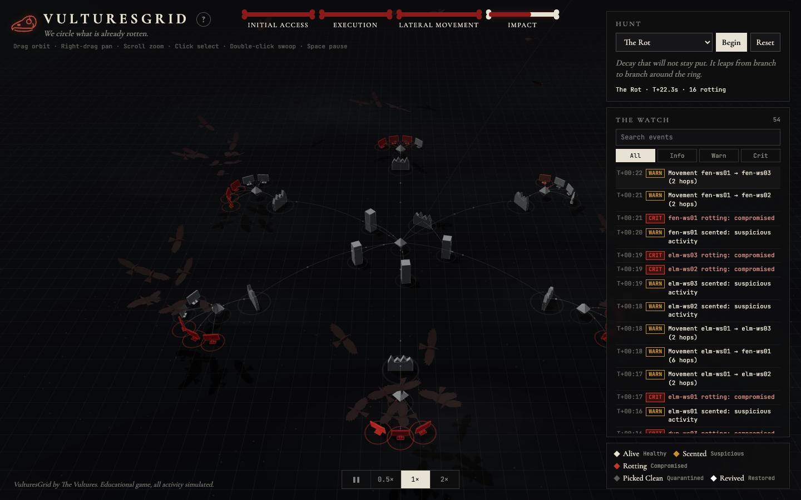
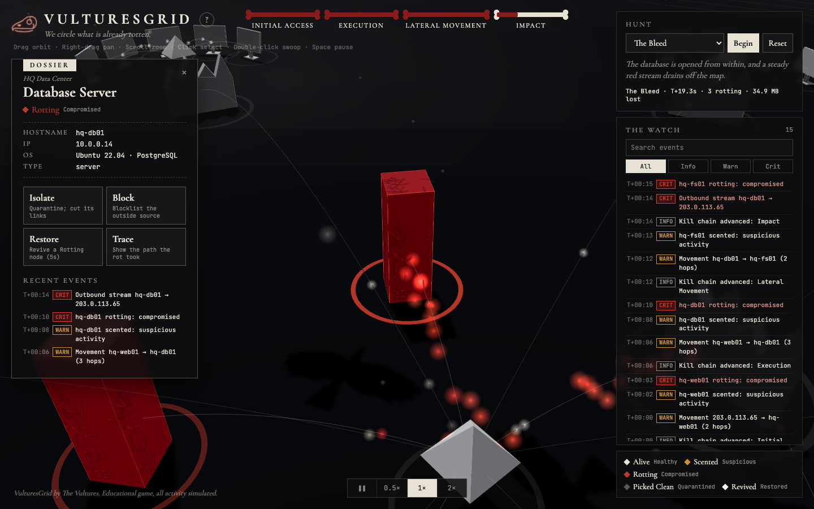
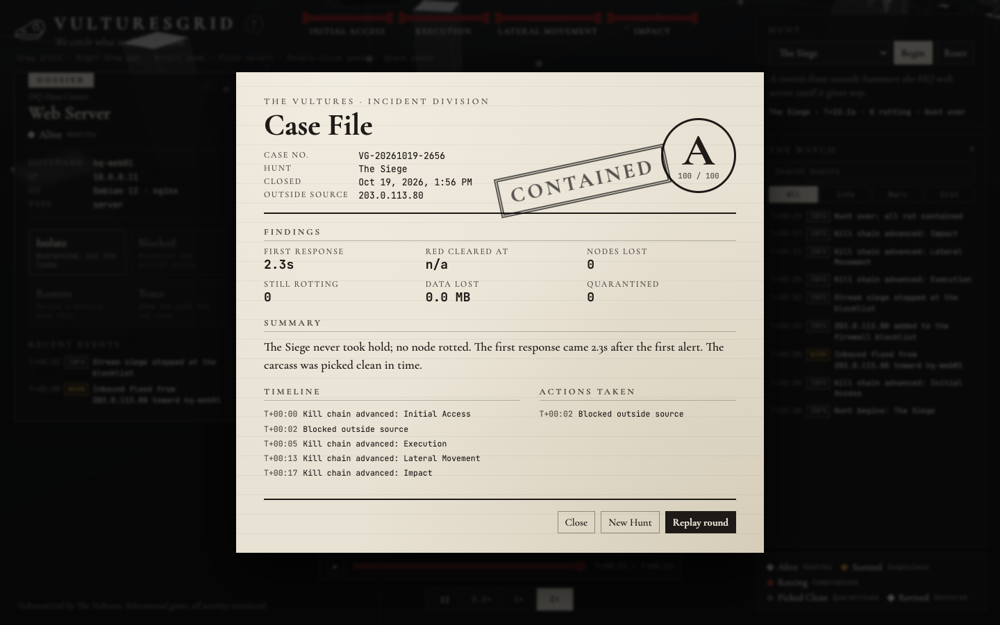
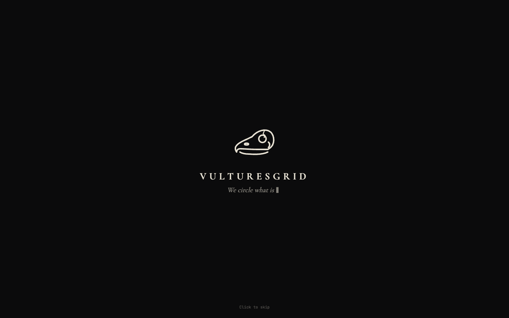

# VulturesGrid

> *We circle what is already rotten.*

**VulturesGrid** is a browser-based 3D network game from **The Vultures**. You play a Vulture: a watcher who spots decay spreading through a company network early and contains it before it consumes the whole carcass.

It is a visual game only. There is no real networking, scanning or security tooling. Every node, hostname, IP address and bit of "traffic" is made up and drawn as shapes and particles in Three.js. Everything runs in the browser, with no backend.

**Live demo:** [vulturesgrid.vercel.app](https://vulturesgrid.vercel.app)

---

## Screenshots

| | |
|---|---|
|  |  |
| *The Rot leaping branch to branch* | *A dossier, The Watch and the Bleed stream* |
|  |  |
| *The end-of-round Case File* | *The loading screen* |

## Features

- **The Carcass:** an HQ data center (core router, firewall, web, domain, file and database servers) ringed by six branch offices. Each node type has its own low-poly shape: tall monoliths for servers, flat panels for workstations, spinning octahedrons for routers and jagged bone walls for firewalls.
- **Four Hunts** (or Random), each a different spreading pattern:
  - **The Lure** hops node by node from a branch workstation to the HQ domain controller.
  - **The Rot** leaps from branch to branch around the ring.
  - **The Siege** sends a swarm from off-map at the web server until it gives way.
  - **The Bleed** drains a red stream from the database off the map.
- **Node states**, always shown with a plain meaning:

  | State | Meaning | Look |
  |---|---|---|
  | Alive | Healthy | bone white |
  | Scented | Suspicious | amber pulse |
  | Rotting | Compromised | crimson, cracks, flicker, vultures circling |
  | Picked Clean | Quarantined | ash gray, wireframe cage |
  | Revived | Restored | white flash, then back to bone |

- **Vultures:** low-poly birds glide in, circle and cast shadows over every rotting node. They scatter when it recovers.
- **Kill chain bar:** four bone segments (Initial Access → Execution → Lateral Movement → Impact) that darken to crimson as a Hunt advances.
- **Dossier panel and four actions**, each with a cooldown:
  - **Isolate:** quarantine a node; nothing passes through it.
  - **Block:** blocklist the outside source; its traffic bounces off the firewall.
  - **Restore:** revive a rotting node after 5 seconds.
  - **Trace:** draw the path the rot took, in crimson.
- **The Watch:** a live event log with INFO / WARN / CRIT tags, search and a severity filter. Click a row to fly to its node.
- **Pause and 0.5× / 1× / 2× speed**, and a smooth spiralling camera swoop when you double-click a node.
- **Case File:** an end-of-round report styled as a stamped investigative document (**CONTAINED** or **CONSUMED**). It includes:
  - a case number and an A–F grade
  - time to first response, when the red was cleared, nodes lost and data lost
  - a timeline, a list of actions taken and an auto-written summary
- **Replay:** after a round, scrub the timeline to any moment and watch it play back.
- **Ambient sound** (off by default; speaker button or `M`): wind gusts, a low rumble, and distant wingbeats that come more often as the rot spreads. It's all generated live with the Web Audio API, with no audio files.
- **Polish:**
  - a loading screen where the skull emblem fades in and the tagline types itself out
  - a **How to Hunt** guide on first visit
  - a logo that pulses while anything rots
  - bottom-sheet panels on phones

## Tech stack

- [Vite](https://vitejs.dev/) with vanilla JavaScript (ES modules, no framework)
- [Three.js](https://threejs.org/) for rendering, `OrbitControls`, shadows and custom geometry
- Plain CSS, with Cormorant Garamond and JetBrains Mono from Google Fonts
- No backend: a static site that deploys to Vercel with zero config

## Local setup

Requires Node.js 18 or newer.

```bash
npm install
npm run dev       # http://localhost:5173
npm run build     # production build in /dist
npm run preview   # serve the /dist build locally
```

Handy deep links for development or sharing:

- `?hunt=bleed` starts a Hunt immediately. Use `lure`, `rot`, `siege`, `bleed` or `random`.
- `&skip=15` fast-forwards that many seconds.
- `&focus=hq-db` frames a node and opens its dossier.

## Deploying to Vercel

Import the repository in Vercel. It detects Vite automatically: the build command is `npm run build` and the output directory is `dist`. No configuration file is needed.

## Project structure

```
src/
  main.js            wires everything together and runs the frame loop
  style.css
  scene/             Three.js: stage, fog, nodes, links, pulses, vultures, trace, camera swoop, picking
  sim/               game logic, no rendering
    topology.js      the map: nodes, layout, links
    hunts.js         Hunt definitions (data-only timelines)
    engine.js        plays a Hunt, owns node states, actions, cooldowns, the event log
    replay.js        records a round for the timeline scrubber
    scoring.js       grades a round and builds the Case File
    states.js        state names and meanings
  ui/                DOM panels: kill chain, Hunt panel, dossier, The Watch, timeline,
                     Case File, help modal, loading screen, logo
  assets/
    skull.svg        the vulture skull emblem
```

### Adding a Hunt

Hunts are plain data in [`src/sim/hunts.js`](src/sim/hunts.js). Each one is a list of timed steps, such as `scent`, `rot`, `spread`, `stream` and `stream-stop`. The step format is documented at the top of that file. Add an object to `HUNTS`; it appears in the dropdown automatically, and you don't need to change the engine.

Grading weights live at the top of [`src/sim/scoring.js`](src/sim/scoring.js).

---

VulturesGrid by The Vultures. Educational game, all activity simulated.
